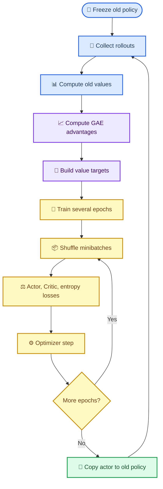

# PPO算法学习

_从基础概念、策略梯度、Actor-Critic 到 PPO 完整计算过程的学习笔记 · 整理日期：2026-11-19_

## 🧭 强化学习基础

### MDP 与策略

强化学习把 Agent 与环境的交互建模为马尔可夫决策过程。时刻 \(t\)：

\[
s_t\rightarrow a_t\sim\pi_\theta(a\mid s_t)
\rightarrow r_t,s_{t+1}
\]

一条轨迹为

\[
\tau=(s_0,a_0,r_0,s_1,a_1,r_1,\ldots,s_T).
\]

策略 \(\pi_\theta(a\mid s)\) 是给定状态时的动作概率分布。

- 离散动作：Actor 输出 softmax logits；
- 连续动作：Actor 输出高斯分布的均值 \(\mu_\theta(s)\) 和标准差 \(\sigma_\theta(s)\)；
- 有界动作：常使用 Gaussian 加 tanh 变换，或 TanhNormal。

### 回报与目标

从 \(t\) 时刻开始的折扣回报：

\[
G_t=r_t+\gamma r_{t+1}+\gamma^2r_{t+2}+\cdots
=\sum_{k=0}^{T-t-1}\gamma^k r_{t+k}.
\]

强化学习希望最大化：

\[
J(\theta)=\mathbb E_{\tau\sim\pi_\theta}[G_0].
\]

PPO 直接优化策略参数，而不是先学习 Q 表、再对动作做 \(\arg\max\)。

### \(V\)、\(Q\) 和优势 \(A\)

| 函数 | 含义 |
| --- | --- |
| \(V^\pi(s)\) | 从状态 \(s\) 开始，按策略 \(\pi\) 行动的平均回报 |
| \(Q^\pi(s,a)\) | 在 \(s\) 先做 \(a\)，之后按 \(\pi\) 行动的平均回报 |
| \(A^\pi(s,a)\) | \(Q^\pi(s,a)-V^\pi(s)\)，即动作相对平均水平的优势 |

\[
V^\pi(s)=\mathbb E_{a\sim\pi}[Q^\pi(s,a)]
\]

\[
A^\pi(s,a)=Q^\pi(s,a)-V^\pi(s).
\]

\(A>0\) 表示这个动作比当前策略的平均动作好；\(A<0\) 表示更差。

### MC 与 TD

蒙特卡洛直接使用完整回报：

\[
G_t=r_t+\gamma r_{t+1}+\gamma^2r_{t+2}+\cdots.
\]

实际上的
$$
V^\pi(s)=\mathbb E[G_t|s_t=s]
$$
我们有一个初始的$V^\pi(s_t)$

如何得到它的准确值？直接计算不就行了！但此时我不一定拿到了所有s出发到达的轨迹，所有可以采用类似于前面增量式更新的方法：
$$
V^\pi(s_t)=V^\pi(s_t)+\eta(G_t-V^\pi(s_t))
$$
这里有点类似于梯度下降的更新方式了，事实上两者的思路就是相同的，$G_t$为一条从$s_t$出发获得的轨迹

这样一条一条计算还是有些慢

时序差分只走一步，用当前价值估计未来：
$$
\widehat G_t=r_t+\gamma V_\phi(s_{t+1}).
$$

放在TD中，就可以定义TD error为（这一概念会在后面的优势函数中再次出现）
\[
\delta_t=r_t+\gamma V_\phi(s_{t+1})-V_\phi(s_t).
\]

有个问题，我们是想要算出更好的$V_\phi(s_t)$让它更加接近真实值，那就要对产生这个的网络进行梯度更新，但是我们在这个过程中同样算了$V_\phi(s_{t+1})$，对参数$\phi$求梯度也得对这个进行更新吗？那不是又偏离了我们想要更好地拟合$V$的初衷。所以使用semi-gradient的方法：
$$
\phi\leftarrow \phi+\eta[r_t+\gamma V_\phi(s_{t+1})-V_\phi(s_t)]\nabla_\phi V_\phi(s_t)
$$
MC 的样本方差高，但不需要价值网络（需要一个完整的轨迹）；TD 方差低，但会传播价值网络的估计误差（轨迹中可以做单步更新）。

进一步地，其实还有走多步，介于MC与TD中间，即定义$G_{t:t+k}$以这$k+1$步来做更新（也是真计算，不使用价值网络预测）

## 📊 策略梯度与优势估计

### Log-derivative trick

轨迹概率：

\[
p_\theta(\tau)=p(s_0)\prod_t
\pi_\theta(a_t\mid s_t)p(s_{t+1}\mid s_t,a_t).
\]

我们想做的是什么？（想最大化的是什么）
$$
J(\pi_\theta)=J(\theta)=\mathbb E_{\tau} [R(\tau)p_\theta(\tau)]
$$
$t$时间后的汇报应该同$t$时间前的转移概率是无关的,并且环境转移概率与 \(\theta\) 无关（这就是为什么取$log$的原因所在，求导前面稀疏会消失，这让我想起了机器学习中的知识）。

故策略梯度最终只经过策略概率：
\[
\nabla_\theta J(\theta)
=
\mathbb E
\left[
\sum_t\gamma^{t-1}G_t\nabla_\theta\log\pi_\theta(a_t\mid s_t)
\right].
\]

直觉是：

- 高回报轨迹上的动作，提高其 log probability；
- 低回报轨迹上的动作，降低其 log probability；
- 环境模拟和奖励函数本身不需要可微。

正常REINFORCE直接用这个梯度更新,但一条轨迹也太长了，并且$G_t$会让整个更新方差比较大

没得到一整条轨迹怎么办，其实$G_t$可以用一个$Q_\theta(s,a)$代替嘛。

### Baseline 与优势

给回报减去**只依赖状态**的 baseline \(b(s)\)，不会改变梯度期望：

\[
\mathbb E_{a\sim\pi}
\left[b(s)\nabla_\theta\log\pi_\theta(a\mid s)\right]
=
b(s)\nabla_\theta\sum_a\pi_\theta(a\mid s)
=0.
\]

因此：

\[
\nabla J
=
\mathbb E
\left[
(G_t-b(s_t))
\nabla\log\pi_\theta(a_t\mid s_t)
\right].
\]

通常取 \(b(s)=V_\phi(s)\)，这样就会得到前面定义的优势函数近似：

\[
\widehat A_t=G_t-V_\phi(s_t).
\]

> 优势函数不是$A^\pi(s,a)=Q^\pi(s,a)-V^\pi(s)$吗？
>
> 更定s，a时，$G_t$本身就是$Q^\pi(s,a)$的一个估计，而$V_\phi(s_t)$又是$V^\pi(s)$的估计，还是想不通可以想想Q的定义

### Actor 与 Critic

| 网络 | 参数 | 输入 | 输出 | 学习目标 |
| --- | --- | --- | --- | --- |
| Actor | \(\theta\) | 状态/观测 | 动作分布参数 | 增大高优势动作概率，降低低优势动作概率 |
| Critic | \(\phi\) | 状态/观测 | 标量 \(V_\phi(s)\) | 预测从该状态开始的未来回报 |

标准 PPO 是 Actor-Critic 算法。

### GAE

GAE 把多步 TD 误差加权组合（$G_t$在TD中被替代）：

\[
\delta_t=r_t+\gamma V_\phi(s_{t+1})-V_\phi(s_t)
\]

\[
\widehat A_t^{\mathrm{GAE}}
=\delta_t+\gamma\lambda\delta_{t+1}
+(\gamma\lambda)^2\delta_{t+2}+\cdots
\]

递推形式：

\[
\widehat A_t
=
\delta_t+\gamma\lambda\widehat A_{t+1}.
\]

- \(\lambda=0\)：接近一步 TD，偏差大、方差小；
- \(\lambda=1\)：接近 MC，偏差小、方差大；
- 常用值如 \(0.95\)：多数任务上的折中。

## ⚙️ PPO 的核心计算

### 为什么需要旧策略

PPO 希望用一批 rollout 训练多个 epoch。但 rollout 由旧策略 \(\pi_{\mathrm{old}}\) 产生，参数一旦更新，数据分布就与当前策略不同。

importance sampling 用来修正这个问题：

\[
\mathbb E_{a\sim\pi_\theta}[f(a)]
=
\mathbb E_{a\sim\pi_{\mathrm{old}}}
\left[
\frac{\pi_\theta(a\mid s)}
{\pi_{\mathrm{old}}(a\mid s)}
f(a)
\right].
\]

这个系数就是 PPO 的概率比。

### 概率比是什么

\[
\boxed{
\rho_t(\theta)
=
\frac{
\pi_\theta(a_t\mid s_t)
}{
\pi_{\mathrm{old}}(a_t\mid s_t)
}
}
\]

它比较的是：**在同一个状态 \(s_t\) 上，对 rollout 中同一个动作 \(a_t\)，新策略与旧策略给出的概率或概率密度。**

它不是：

- 新旧动作的比值；
- 新旧 Q 值的比值；
- 当前奖励与旧奖励的比值。

更新刚开始时：

\[
\theta=\theta_{\mathrm{old}}
\Rightarrow
\rho_t=1.
\]

经过一个或多个 minibatch 后，\(\rho_t\) 才偏离 1。

### 连续高斯策略如何计算概率比

一维高斯密度：

\[
p(a\mid\mu,\sigma)
=
\frac1{\sqrt{2\pi}\sigma}
\exp\left[
-\frac{(a-\mu)^2}{2\sigma^2}
\right].
\]

假设旧 Actor 输出：

\[
\mu_{\mathrm{old}}=0,\qquad\sigma_{\mathrm{old}}=1
\]

rollout 采样并保存：

\[
a=0.4
\]

随后 Actor 更新为：

\[
\mu_{\mathrm{new}}=0.2,\qquad\sigma_{\mathrm{new}}=1.
\]

更新时不需要重新采样动作 \(a\)，只需在同一状态下计算：

\[
\pi_{\mathrm{old}}(0.4\mid s)
\approx0.3683
\]

\[
\pi_{\mathrm{new}}(0.4\mid s)
\approx0.3910.
\]

因此：

\[
\rho=
\frac{0.3910}{0.3683}
\approx1.0618.
\]

含义是：对于 rollout 中实际选过的动作，新策略的概率密度提高了约 6.18%。

代码中通常保存 log probability：

```python
ratio = torch.exp(log_prob_new - log_prob_old.detach())
```

多维动作使用联合 log probability；独立高斯时对每一维 log density 求和。

> 📌 连续动作有一个精确值出现的概率为 0，因此这里比较的是概率密度，而不是离散概率。

### 裁剪目标

最基础的策略替代目标是

\[
L^{\mathrm{CPI}}(\theta)
=
\mathbb E_t[\rho_t\widehat A_t].
\]

直接最大化它会让策略在同一条旧数据上走得太远。PPO 改为：

\[
\boxed{
L^{\mathrm{CLIP}}(\theta)
=
\mathbb E_t
\left[
\min
\left(
\rho_t\widehat A_t,
\operatorname{clip}
(\rho_t,1-\epsilon,1+\epsilon)
\widehat A_t
\right)
\right].
}
\]

设 \(\epsilon=0.2\)，可信区间是：

\[
[0.8,1.2].
\]

| 优势 | Actor 想做什么 | PPO 在什么区域停止奖励继续更新 |
| --- | --- | --- |
| \(\widehat A_t>0\) | 提高动作概率，使 \(\rho_t\) 变大 | \(\rho_t>1+\epsilon\) |
| \(\widehat A_t<0\) | 降低动作概率，使 \(\rho_t\) 变小 | \(\rho_t<1-\epsilon\) |

被 clip 不等于样本被删掉：

- 它仍参与当前目标值计算；
- 仍可用于 Critic 损失；
- 仍可能参与熵损失；
- 当后续参数变化让概率比回到区间内时，Actor 梯度会恢复。

clip 只截断“沿已经过度优化方向的继续收益”，反向纠正仍然可以产生梯度。

### Actor 与 Critic 的损失

Actor 希望最大化 \(L^{\mathrm{CLIP}}\)，优化器通常做最小化，因此：

\[
\boxed{
L_{\mathrm{Actor}}
=
-
\mathbb E_t
\left[
\min
\left(
\rho_t\widehat A_t,
\operatorname{clip}
(\rho_t,1-\epsilon,1+\epsilon)
\widehat A_t
\right)
\right].
}
\]

在未触发 clip 的区域：

\[
\nabla_\theta L_{\mathrm{Actor}}
=
-
\mathbb E_t
\left[
\rho_t\widehat A_t
\nabla_\theta\log\pi_\theta(a_t\mid s_t)
\right].
\]

这来自：

\[
\nabla_\theta\rho_t
=
\rho_t
\nabla_\theta\log\pi_\theta(a_t\mid s_t).
\]

采样动作 \(a_t\)、优势 \(\widehat A_t\)、旧概率都是常量；梯度只经过当前 Actor 的 log probability。

Critic 的价值目标通常取：

\[
R_t=\widehat A_t+V_{\mathrm{old}}(s_t).
\]

这是常见的 GAE return 形式。另一些教学实现让 Critic 直接回归一步 TD target \(r_t+\gamma(1-d_t)V(s_{t+1})\)。二者都是对回报目标的近似，但不应把公式混写成同一个目标。

标准 MSE：

\[
\boxed{
L_{\mathrm{Critic}}
=
\frac1T\sum_t
\left(V_\phi(s_t)-R_t\right)^2.
}
\]

Critic 梯度：

\[
\nabla_\phi L_{\mathrm{Critic}}
=
\frac2T\sum_t
\left(V_\phi(s_t)-R_t\right)
\nabla_\phi V_\phi(s_t).
\]

不少实现使用 clipped value loss：

\[
L_V
=
\max
\left[
(V_\phi(s_t)-R_t)^2,
(V_\phi^{\mathrm{clip}}(s_t)-R_t)^2
\right].
\]

\[
\boxed{
L
=
L_{\mathrm{Actor}}
+c_vL_{\mathrm{Critic}}
-c_eH(\pi_\theta).
}
\]

其中：

- \(c_v\)：价值损失系数；
- \(c_e\)：熵奖励系数；
- \(H(\pi_\theta)\)：策略熵，用于维持动作多样性。

训练时需要 detach：

```python
advantage = advantage.detach()
returns = returns.detach()
log_prob_old = log_prob_old.detach()
old_value = old_value.detach()
```

这样 Actor 损失不会错误地把梯度传入 GAE 或旧价值路径。

## 🔄 一次完整 PPO 迭代

### rollout 阶段



rollout buffer 至少保存：

```text
obs          : [num_envs, obs_dim]
action       : [num_envs, action_dim]
reward       : [num_envs]
done         : [num_envs]
log_prob_old : [num_envs]
value_old    : [num_envs]
```

连续采集 `num_steps_per_env` 步后得到：

```text
obs          : [steps, num_envs, obs_dim]
action       : [steps, num_envs, action_dim]
advantage    : [steps, num_envs]
return_target: [steps, num_envs]
```

## 之后是用deepseek生成的一些示例和代码库中PPO算法对应的地方：

### 三状态数值例子

设：

\[
\gamma=0.9,\qquad\lambda=0.8,\qquad\epsilon=0.2.
\]

| 时刻 | 状态 | 奖励 \(r_t\) | 旧价值 \(V(s_t)\) |
| --- | --- | ---: | ---: |
| 0 | \(s_0\) | 1.0 | 1.0 |
| 1 | \(s_1\) | -1.0 | 1.5 |
| 2 | \(s_2\) | 2.5 | 2.0 |

终止状态价值视为 0。

TD 误差：

\[
\delta_2=2.5-2.0=0.5
\]

\[
\delta_1=-1+0.9\times2.0-1.5=-0.7
\]

\[
\delta_0=1+0.9\times1.5-1.0=1.35
\]

GAE 优势从后向前：

\[
\widehat A_2=0.5
\]

\[
\widehat A_1=-0.7+0.72\times0.5=-0.34
\]

\[
\widehat A_0=1.35+0.72\times(-0.34)=1.1052
\]

价值目标：

\[
R_0=1.1052+1.0=2.1052
\]

\[
R_1=-0.34+1.5=1.16
\]

\[
R_2=0.5+2.0=2.5
\]

假设概率比分别为：

| 时刻 | \(\rho_t\) | \(\widehat A_t\) | 未裁剪 | 裁剪后 | PPO 选择 |
| --- | ---: | ---: | ---: | ---: | ---: |
| 0 | 1.25 | 1.1052 | 1.3815 | 1.3262 | 1.3262 |
| 1 | 0.75 | -0.34 | -0.2550 | -0.2720 | -0.2720 |
| 2 | 1.10 | 0.5 | 0.5500 | 0.5500 | 0.5500 |

平均策略目标：

\[
\frac{1.3262-0.2720+0.55}{3}
\approx0.5347.
\]

因此 Actor 最小化损失：

\[
L_{\mathrm{Actor}}\approx-0.5347.
\]

如果更新后 Critic 输出：

\[
V_{\mathrm{new}}=[1.15,1.30,2.20],
\]

则价值损失约为：

\[
\frac{
(1.15-2.1052)^2+
(1.30-1.16)^2+
(2.20-2.50)^2
}{3}
\approx0.341.
\]

### 更新循环伪代码

```python
for iteration in range(max_iterations):
    old_actor = copy(actor)

    rollout = env_rollout(old_actor, num_steps)
    advantages, returns = compute_gae(
        rollout.rewards,
        rollout.dones,
        rollout.values,
        gamma,
        lam,
    )

    for epoch in range(num_epochs):
        for batch in shuffle_minibatches(rollout):
            dist = actor(batch.obs)
            log_prob = dist.log_prob(batch.action).sum(-1)

            ratio = torch.exp(
                log_prob - batch.log_prob_old.detach()
            )

            actor_obj = torch.minimum(
                ratio * batch.advantage.detach(),
                ratio.clamp(1 - eps, 1 + eps)
                * batch.advantage.detach(),
            )
            actor_loss = -actor_obj.mean()

            value = critic(batch.obs)
            critic_loss = (
                (value - batch.returns.detach()) ** 2
            ).mean()

            entropy = dist.entropy().sum(-1).mean()
            loss = (
                actor_loss
                + value_coef * critic_loss
                - entropy_coef * entropy
            )

            optimizer.zero_grad()
            loss.backward()
            clip_grad_norm(parameters, max_grad_norm)
            optimizer.step()
```

### Hands-on-RL 原始公式对照

这份实现使用的 Critic target 是一步 TD target：

\[
\widehat R_t^{\mathrm{TD}}
=
r_t+\gamma(1-d_t)V_\phi(s_{t+1})
\]

对应的 TD 误差：

\[
\delta_t
=
\widehat R_t^{\mathrm{TD}}-V_\phi(s_t)
\]

优势由本地工具函数
[`compute_advantage()`](D:/rl_lab/Hands-on-RL/rl_utils.py#L81) 计算：

```python
def compute_advantage(gamma, lmbda, td_delta):
    td_delta = td_delta.detach().numpy()
    advantage = 0.0
    advantage_list = []
    for delta in td_delta[::-1]:#递减
        advantage = gamma * lmbda * advantage + delta
        advantage_list.append(advantage)
    advantage_list.reverse()
    return torch.tensor(advantage_list, dtype=torch.float)
```

即从轨迹末尾向前递推：

\[
\widehat A_t
=
\delta_t+\gamma\lambda\widehat A_{t+1}.
\]

离散版本的完整核心代码如下：

```python
# 一步 TD target: R_t = r_t + gamma * V(s_{t+1})
td_target = rewards + self.gamma * self.critic(next_states) * (1 - dones)

# TD error: delta_t = R_t - V(s_t)
td_delta = td_target - self.critic(states)

# GAE: A_t = delta_t + gamma * lambda * A_{t+1}
advantage = rl_utils.compute_advantage(
    self.gamma, self.lmbda, td_delta.cpu()
).to(self.device)

# old_logp = log pi_old(a_t | s_t)
old_log_probs = torch.log(
    self.actor(states).gather(1, actions)
).detach()

for _ in range(self.epochs):
    # logp_new = log pi_theta(a_t | s_t)
    log_probs = torch.log(self.actor(states).gather(1, actions))

    # ratio = pi_theta(a_t | s_t) / pi_old(a_t | s_t)
    ratio = torch.exp(log_probs - old_log_probs)

    # 未裁剪目标与裁剪目标
    surr1 = ratio * advantage
    surr2 = torch.clamp(
        ratio, 1 - self.eps, 1 + self.eps
    ) * advantage

    # Actor: -E[min(surr1, surr2)]
    actor_loss = torch.mean(-torch.min(surr1, surr2))

    # Critic: MSE(V(s_t), R_t)
    critic_loss = torch.mean(
        F.mse_loss(self.critic(states), td_target.detach())
    )

    # 两个网络分别清空梯度
    self.actor_optimizer.zero_grad()
    self.critic_optimizer.zero_grad()

    # 分别反向传播
    actor_loss.backward()
    critic_loss.backward()

    # 分别更新 Actor 和 Critic
    self.actor_optimizer.step()
    self.critic_optimizer.step()
```

公式与代码的对应关系：

| 原始公式 | Hands-on-RL 代码 |
| --- | --- |
| \(\widehat R_t=r_t+\gamma(1-d_t)V(s_{t+1})\) | `td_target = ...` |
| \(\delta_t=\widehat R_t-V(s_t)\) | `td_delta = td_target - self.critic(states)` |
| \(\widehat A_t=\delta_t+\gamma\lambda\widehat A_{t+1}\) | `compute_advantage(...)` |
| \(\log\pi_{\mathrm{old}}(a_t\mid s_t)\) | `old_log_probs = ... .detach()` |
| \(\rho_t=\exp(\log\pi_\theta-\log\pi_{\mathrm{old}})\) | `ratio = torch.exp(...)` |
| \(L_{\mathrm{Actor}}=-\mathbb E[\min(\rho A,\operatorname{clip}(\rho)A)]\) | `actor_loss = ...` |
| \(L_{\mathrm{Critic}}=\mathbb E[(V_\phi(s)-R_t)^2]\) | `critic_loss = ...` |
| 分别更新两个网络 | 两个 optimizer、两次 backward |

连续动作版本只改变 Actor 的分布：

\[
a\sim\mathcal N(\mu_\theta(s),\sigma_\theta(s)^2)
\]

代码使用：

```python
mu = 2.0 * torch.tanh(self.fc_mu(x))
std = F.softplus(self.fc_std(x))
action_dist = torch.distributions.Normal(mu, std)
action = action_dist.sample()
```

当前策略与旧策略对同一个已采动作的 log probability 仍然通过普通高斯 log density 计算，概率比和 clip 公式完全不变。

> 📌 这份教学实现使用两个独立优化器，分别执行 `actor_loss.backward()` 和 `critic_loss.backward()`，并且没有显式熵损失。
>
> 因此，“把三项损失写成一个总损失并统一反传”是常见实现方式，不是 PPO 的硬性要求。Actor/Critic 参数分离时，分别反传与把损失相加在数学上等价；共享网络层时，统一反传才会自然合并共享层的梯度。

## 🤖 在具身任务中的映射

### Isaac Lab 中的 PPO

以当前工作区的 `Isaac-Reach-Franka` 为例：

```bash
uv run isaaclab train --rl_library rsl_rl \
    --task Isaac-Reach-Franka \
    --num_envs 64 \
    --max_iterations 10 \
    --run_name ppo_smoke
```

训练链路：

```text
任务注册
  → 创建 Isaac Lab 并行环境
  → RslRlVecEnvWrapper
  → OnPolicyRunner
  → Actor/Critic + rollout + GAE + PPO
```

关键源码：

- [训练入口](D:/rl_lab/IsaacLab/source/isaaclab_rl/isaaclab_rl/entrypoints/backends/train_rsl_rl.py:157)
- [RSL-RL 环境包装](D:/rl_lab/IsaacLab/source/isaaclab_rl/isaaclab_rl/rsl_rl/vecenv_wrapper.py:146)
- [Reach PPO 配置](D:/rl_lab/IsaacLab/source/isaaclab_tasks/isaaclab_tasks/core/reach/config/franka/agents/rsl_rl_ppo_cfg.py:14)
- [TorchRL PPO 参考实现](D:/rl_lab/IsaacLab/source/isaaclab_rl/isaaclab_rl/torchrl/ppo.py:84)

### 具身 Lab 代码选择

当前工作区有两份与具身任务相关的 Lab 代码，但它们的 PPO 代码完整度不同：

| 仓库 | 本地代码职责 | PPO 公式位置 |
| --- | --- | --- |
| `unitree_rl_lab-main` | 注册 Unitree 具身任务、创建 Isaac Lab 环境、构造 `OnPolicyRunner` | 仓库本地只有配置与训练入口，核心更新位于外部 `rsl_rl` 包 |
| `IsaacLab` | 提供具身任务、环境包装和一套 TorchRL PPO 参考实现 | [torchrl/ppo.py](D:/rl_lab/IsaacLab/source/isaaclab_rl/isaaclab_rl/torchrl/ppo.py) 内含完整训练循环 |

`unitree_rl_lab` 的训练入口执行到：

```python
env = RslRlVecEnvWrapper(env, clip_actions=agent_cfg.clip_actions)
runner = OnPolicyRunner(env, agent_cfg.to_dict(), log_dir=log_dir)
runner.learn(num_learning_iterations=agent_cfg.max_iterations)
```

它的 PPO 配置可以说明实际机器人任务怎样设置 Actor、Critic、GAE、clip、学习率和 epoch：

```python
policy = RslRlPpoActorCriticCfg(
    init_noise_std=1.0,
    actor_hidden_dims=[512, 256, 128],
    critic_hidden_dims=[512, 256, 128],
    activation="elu",
)

algorithm = RslRlPpoAlgorithmCfg(
    value_loss_coef=1.0,
    use_clipped_value_loss=True,
    clip_param=0.2,
    entropy_coef=0.01,
    num_learning_epochs=5,
    num_mini_batches=4,
    learning_rate=1.0e-3,
    gamma=0.99,
    lam=0.95,
    desired_kl=0.01,
)
```

选择 Isaac Lab 的 TorchRL PPO 参考实现为例

### Isaac Lab 原始公式代码

创建高斯 Actor：

```python
net = nn.Sequential(
    _mlp(
        env,
        "policy",
        2 * action_spec.shape[-1],
        cfg.actor_hidden_dims,
        cfg.activation,
    ),
    NormalParamExtractor(
        scale_mapping=f"biased_softplus_{cfg.init_noise_std}"
    ),
)

distribution_class = (
    TanhNormal if isinstance(action_spec, Bounded)
    else IndependentNormal
)
```

网络最后一层输出 \(2d\) 个维度，其中一半作为动作均值，另一半转换为动作标准差参数。对于有界机器人动作，使用 `TanhNormal` 把动作映射到允许范围。

创建标量 Critic：

```python
key = (
    "critic"
    if env.observation_spec.get("critic", None) is not None
    else "policy"
)
critic = ValueOperator(
    _mlp(env, key, 1, cfg.critic_hidden_dims, cfg.activation),
    in_keys=[key],
)
```

创建 GAE 和 PPO 损失模块：

```python
advantage = GAE(
    gamma=cfg.gamma,
    lmbda=cfg.lam,
    value_network=critic,
    average_gae=True,
)

loss_module = ClipPPOLoss(
    actor,
    critic,
    clip_epsilon=cfg.clip_param,
    entropy_bonus=cfg.entropy_coef > 0,
    entropy_coeff=cfg.entropy_coef,
    critic_coeff=cfg.value_loss_coef,
    clip_value=cfg.use_clipped_value_loss,
)
```

公式对应：

| 公式 | Isaac Lab 代码 |
| --- | --- |
| \(\widehat A_t=\mathrm{GAE}(\delta_t;\gamma,\lambda)\) | `advantage = GAE(...)` |
| \(\rho_t=\pi_\theta/\pi_{\mathrm{old}}\) | `ClipPPOLoss` 内部计算 |
| \(L^{\mathrm{CLIP}}\) | `ClipPPOLoss` 返回的 policy loss |
| \(L_V\) | `ClipPPOLoss` 返回的 critic loss |
| \(-c_eH\) | `ClipPPOLoss` 返回的 entropy loss |

采集与优化循环：

```python
frames_per_batch = (
    env.batch_size[0] * cfg.num_steps_per_env
)

collector = Collector(
    env,
    actor,
    frames_per_batch=frames_per_batch,
    total_frames=frames_per_batch * cfg.max_iterations,
)

for batch in collector:
    for _ in range(cfg.num_learning_epochs):
        with torch.no_grad():
            advantage(batch)

        samples = batch.reshape(-1)

        for indices in torch.randperm(
            samples.shape[0],
            device=samples.device,
        ).chunk(cfg.num_mini_batches):
            optimizer.zero_grad(set_to_none=True)

            # 返回 loss_objective、loss_critic、loss_entropy 等项
            terms = loss_module(samples[indices])

            # 将全部 loss_* 项合成一个标量后统一反传
            total_loss = sum(
                value
                for key, value in terms.items()
                if key.startswith("loss_")
            )
            total_loss.backward()

            nn.utils.clip_grad_norm_(
                loss_module.parameters(),
                cfg.max_grad_norm,
            )
            optimizer.step()

    # 让 collector 使用刚更新后的 Actor
    collector.update_policy_weights_()
```

这里的 `loss_module.parameters()` 同时包含 Actor 和 Critic。一次 `backward()` 会在两套参数上分别累积梯度：

\[
\nabla_\theta L
=
\nabla_\theta L_{\mathrm{Actor}}
-c_e\nabla_\theta H
\]

\[
\nabla_\phi L
=
c_v\nabla_\phi L_{\mathrm{Critic}}
\]

代码按 epoch 重复训练同一批 rollout；每次迭代结束后，`collector.update_policy_weights_()` 把新 Actor 设为下一批 rollout 的采样策略。

### 网络与动作

Franka Reach 默认 Actor 和 Critic 均为两层 64 维 MLP。

- Actor 输出高斯分布，用于机械臂关节动作；
- Critic 输出一个标量状态价值；
- Joint Position Action 将网络输出转换为关节目标；
- 环境使用 `decimation` 在多个物理子步中保持同一策略动作。

### 观察与调试指标

训练前先检查环境契约：

- 动作是否控制预期关节；
- 观测是否随机器人状态变化；
- 接近目标时奖励是否改善；
- reset 是否只重置已结束的并行环境；
- 动作范围、物理步长和 `decimation` 是否匹配。

PPO 训练中重点观察：

| 指标 | 健康趋势 |
| --- | --- |
| 平均奖励 | 总体上升 |
| 近似 KL | 保持在目标附近 |
| clip fraction | 不过高 |
| entropy | 不迅速塌缩到 0 |
| value loss | 总体下降 |
| explained variance | 趋近正值 |

## 🔍 关键疑问

### 为什么采样动作仍能对 Actor 求导

PPO 更新时不会对采样操作求导，也不会让梯度经过环境。

动作 \(a_t\) 是 rollout 中保存的常量。当前 Actor 只在同一个点计算概率密度：

\[
\pi_\theta(a_t\mid s_t).
\]

梯度来自 log probability：

\[
\nabla_\theta\log\pi_\theta(a_t\mid s_t).
\]

这是 score-function policy gradient，不要求动作采样本身可微。

### rollout 能否直接计算价值

完整 episode 的 rollout 可以计算：

\[
G_t=\sum_{k=0}^{T-t-1}\gamma^kr_{t+k}.
\]

它能给出某个具体状态动作的一次回报样本，近似用于：

\[
\widehat Q(s_t,a_t)\approx G_t.
\]

但一次轨迹只是随机环境中的一个样本，不是期望值。两个同状态轨迹可能分别返回 1 和 9，而真正的 Q 可能约为 5。

### 为什么还需要 Critic

Critic 的价值在于：

1. 提供 baseline \(V(s)\)，显著降低策略梯度方差；
2. 支持 GAE，不必等完整 episode；
3. 为固定长度或截断 rollout 提供 bootstrap；
4. 跨大量并行环境学习状态价值，而不是为每个 \((s,a)\) 等待大量重复采样。

标准 PPO 使用 Critic，但 Critic 不是 PPO 的绝对数学前提。可以用 MC return 或 GRPO 式组内相对回报替代，代价是更高方差或更多采样。

### clip 后样本还有什么用

被 clip 的样本没有从 batch 删除。它仍然：

- 决定当前裁剪目标值和边界是否触发；
- 参与 Critic 的价值回归；
- 参与熵损失；
- 可能在其他 epoch 中重新进入未裁剪区间。

PPO 只是停止在这一方向上额外奖励策略继续远离旧策略。

### 常见误区

| 误区 | 正确理解 |
| --- | --- |
| PPO 裁剪 advantage | 裁剪的是概率比 \(\rho_t\) |
| \(\pi_{\mathrm{old}}\) 也参与更新 | 旧概率或旧策略快照固定 |
| 概率比是动作比 | 是同一动作在新旧策略下的概率/密度比 |
| clip 会删除样本 | 样本仍参与其他损失和后续判定 |
| PPO 必须使用价值网络 | 标准实现使用 Actor-Critic，但不是唯一方案 |
| 环境 reward 必须可微 | 不需要，reward 只作为优势权重 |
| ratio 越大策略一定越好 | ratio 只表示概率变化，优劣由 advantage 决定 |

## 自测

1. 为什么概率比在每轮更新开始时等于 1？
2. 连续动作中为什么比较的是概率密度？
3. Critic 为什么输出一个标量而不是每个动作的 Q？
4. GAE 从前往后算还是从后往前算？
5. 正优势样本何时被 clip？
6. 负优势样本何时被 clip？
7. Actor 损失对 \(\mu_\theta\) 的梯度如何产生？
8. 为什么优势张量要 detach？
9. 哪些情况下可以不使用 Critic？
10. 为什么同一批 rollout 可以训练多个 epoch？

<details>
<summary><strong>📋 自测答案</strong></summary>


1. 因为该轮初始参数就是旧策略参数，所以新旧概率相同。
2. 连续动作的精确值概率为 0，使用概率密度在某动作点上的取值。
3. Critic 估计状态平均价值，作为 baseline；实际动作的回报由 rollout 或 GAE 提供。
4. 从轨迹末尾向前递推。
5. 正优势且概率比超过 \(1+\epsilon\) 时，停止继续提高概率。
6. 负优势且概率比低于 \(1-\epsilon\) 时，停止继续降低概率。
7. Actor 输出 \(\mu_\theta(s)\)，高斯 log density 对 \(\mu_\theta\) 可微。
8. 避免 Actor 梯度流进优势、旧价值和 GAE 计算路径。
9. 使用完整 MC 回报或组内相对优势等替代方案时可以直接省去 Critic。
10. 旧概率被冻结，clip 限制当前策略相对旧策略走得过远。

</details>

---

## 📌 一页速查

```text
1. 用旧 Actor 收集状态、动作、奖励、done、old_logp、old_value
2. 用 Critic/GAE 计算 advantage
3. 构造价值目标 returns = advantage + old_value
4. 当前 Actor 对已采动作重新计算 logp
5. ratio = exp(logp_new - logp_old)
6. 用 advantage 决定增大或减小动作概率
7. PPO 用 clip 限制一次更新过远
8. 优化 Actor、Critic 和 entropy
9. 多 epoch 使用旧 rollout
10. 刷新旧策略，重新采样
```

最小必记公式：

\[
\rho_t=
\frac{\pi_\theta(a_t\mid s_t)}
{\pi_{\mathrm{old}}(a_t\mid s_t)}
\]

\[
L^{\mathrm{CLIP}}
=
\mathbb E
\left[
\min
\left(
\rho_t\widehat A_t,
\operatorname{clip}
(\rho_t,1-\epsilon,1+\epsilon)
\widehat A_t
\right)
\right]
\]

\[
L_V=
\mathbb E
\left[
(V_\phi(s_t)-R_t)^2
\right]
\]

一句话理解 PPO：

> **旧策略负责采样并保存动作概率，Critic 判断动作相对平均价值有多好，新 Actor 对同一个旧动作重新打分；优势决定往哪改，概率比衡量改了多少，clip 防止一次改得太远。**
