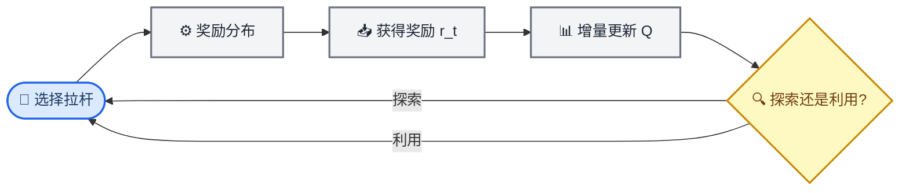

# 多臂老虎机（MAB）问题

> 日期：2026-11月
> 依据：张伟楠、沈键、俞勇，《动手学强化学习》第 2 章“多臂老虎机问题”。官方网站：<https://hrl.boyuai.com/>；配套代码仓库：<https://github.com/boyu-ai/Hands-on-RL>

## 2.1 多臂老虎机到底是什么

多臂老虎机（multi-armed bandit，MAB）是一台有 `K` 根拉杆的机器。每根拉杆对应一个未知奖励分布，算法每次只能选择一根拉杆，并根据抽到的奖励逐步估计哪根拉杆最好。目标不是预测一个标签，而是在 `T` 次选择内尽可能提高累计奖励[^1]。

形式上，可以用动作集合 `\mathcal{A}` 和条件奖励分布 `R(r \mid a)` 描述：

```text
动作：a_t ∈ A = {a_1, ..., a_K}
奖励：r_t ～ R(· | a_t)
目标：max E[Σ_{t=1}^T r_t]
```

与完整强化学习相比，MAB 没有状态转移，也没有“当前动作改变未来环境”的效应。因此它是最简单的无状态决策问题，专门用来研究探索与利用。



## 2.2 奖励、价值与累积懊悔

对于动作 `a`，其真实期望奖励定义为：

```text
Q(a) = E[r | a]
Q* = max_a Q(a)
```

单步懊悔是当前动作的期望奖励与最优期望奖励之差：

```text
R(a_t) = Q* - Q(a_t)
```

执行 `T` 步后的累积懊悔为：

```text
Regret_T = Σ_{t=1}^T [Q* - Q(a_t)]
         = T Q* - Σ_{t=1}^T Q(a_t)
```

因此，最大化累计奖励与最小化累积懊悔等价。

> 📌 **需要注意：** 教材和示例代码为了画学习曲线，直接用老虎机的真实 `best_prob` 和每根拉杆的真实 `probs[k]` 计算懊悔。这相当于使用了一个仿真中的“上帝视角”。真实系统只知道已经观测到的随机奖励，不能直接观测真实期望奖励，所以运行中的算法无法自行计算这个精确懊悔。、
>
> 这个只是为了画学习曲线，实际上是增量式期望估计计算懊悔：

## 2.3 增量式期望估计

若动作 `a` 已经被选择 `k` 次，样本奖励为 `r_1, ..., r_k`，其平均估计为：

```text
Q_k = (1/k) Σ_{i=1}^k r_i
```

从第 `k-1` 次估计推到第 `k` 次，可写成：

```text
Q_k = Q_{k-1} + (1/k)[r_k - Q_{k-1}]
```

这个式子可以理解为：

```text
新估计 = 旧估计 + 步长 × 预测误差
```

其中 `r_k - Q_{k-1}` 是本次观测带来的误差，`1/k` 决定新样本占多大权重。与每次重新求和再相除相比，递推更新只需要保留计数和当前估计，时间与空间复杂度都是 `O(1)`。

## 2.4 探索与利用的平衡

- **探索（exploration）**：尝试尚未充分了解的动作，用短期收益换取更准确的信息。
- **利用（exploitation）**：选择当前估计奖励最高的动作，用已有信息争取短期收益。

完全贪婪策略只利用、不探索，因此可能长期锁死在一个并非最优的拉杆上。更合理的策略通常在早期增加探索，在估计逐渐可靠后减少探索。

## 2.4.1 ε-贪婪算法

ε-贪婪算法以概率 `1 - ε` 选择当前估计值最大的动作，以概率 `ε` 从所有动作中随机选择：

```text
a_t =
    argmax_a Q̂(a)       概率 1 - ε
    Uniform(A)          概率 ε
```

固定 `ε` 保留了永久探索能力，但也意味着算法即使已经找到最优动作，仍会持续以固定概率随机尝试其他动作。教材中的 10 臂伯努利实验显示，这种策略的累积懊悔近似线性增长。

若采用随时间衰减的探索概率，例如 `ε_t = 1/t`，探索会逐渐减少。教材实验中，累积懊悔由线性增长变为次线性增长。这里的结论来自特定实验设置，应理解为算法行为的直观说明，而不是对任意问题的无条件保证。

### ε-贪婪伪代码

```python
# 输入：K 个动作、总步数 T、初始值 Q0、探索序列 ε_t
N[a] = 0
Q_hat[a] = Q0

for t in 1..T:
    if random_uniform() < ε_t:
        a = random_choice(all_arms)          # 探索
    else:
        a = argmax(Q_hat)                    # 利用

    r = environment.pull(a)
    N[a] = N[a] + 1
    Q_hat[a] = Q_hat[a] + (r - Q_hat[a]) / N[a]
```

> 教材实践代码中把初始估值设为 `1.0`，是一种乐观初始化，目的是鼓励早期探索。需要注意，伯努利奖励本身也可能等于 `1.0`，因此这个设置并不严格保证“所有拉杆都会被尝试”；若多个估计仍然并列，`argmax` 的并列处理规则会影响实际选择。

2.4.2 另外两种探索方法

| 方法              | 选择依据                             | 直观思想                           | 主要局限                   |
| ----------------- | ------------------------------------ | ---------------------------------- | -------------------------- |
| UCB               | 估计值 + 不确定性奖励                | 少被尝试的动作不确定性高，值得探索 | 不确定性上界和系数需要设计 |
| Thompson sampling | 从各动作的后验分布采样，再选最大样本 | 用概率模型表达“哪个动作可能最好”   | 需要合理的奖励分布模型     |

UCB 的核心为：

```text
a_t = argmax_a [Q̂(a) + c · Û(a)]
```

在教材实现中，不确定性项采用 `sqrt(log t / (2(N(a)+1)))` 的形式。选择次数越多，不确定性下降；总时间越长，未尝试动作的相对探索价值上升。

Thompson 采样在伯努利奖励下常用 Beta 分布。若某动作获得 `m_1` 次奖励 `1`、`m_2` 次奖励 `0`，其奖励参数可建模为：

```latex
p_a ～ Beta(m_1 + 1, m_2 + 1)
```

每次从所有动作的后验分布各采样一个值，并选择采样值最大的动作。教材实验中，固定 ε 的懊悔近似线性增长，而衰减 ε、UCB 和 Thompson sampling 均表现为次线性增长；UCB 和 Thompson sampling 还具有对数形式的渐近最优懊悔保证。